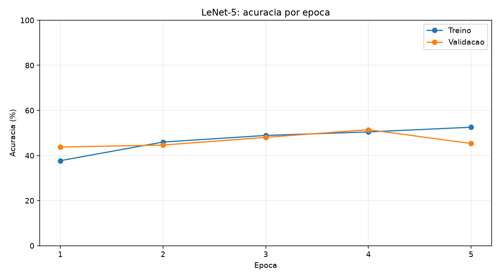

# Engenharia de Agentes de IA

### Portfólio Técnico | Rafael Alexandre Oliveira Araujo

**Python · Machine Learning · Deep Learning · PyTorch · NLP · RAG · LangChain · LangGraph**

> Uma única trilha de Engenharia de IA, organizada desde os fundamentos de redes neurais até o desenvolvimento de agentes inteligentes.

[Dashboard interativo](dashboard.py) | [GitHub](https://github.com/Rafaelaale?tab=repositories) | [LinkedIn](https://www.linkedin.com/in/rafael-araujo-aa10a4232/)

---

## Apresentação profissional

Estudante de **Análise e Desenvolvimento de Sistemas**, em transição profissional da área de saúde para tecnologia.

Desenvolvo projetos práticos de Python, Machine Learning, Deep Learning, processamento de linguagem natural, RAG e engenharia de agentes.

Meu portfólio documenta implementações, experimentos, avaliação de modelos, visualizações e organização de código.

**Interesses profissionais:** Desenvolvimento Python, Engenharia de IA, Machine Learning, Dados, Automação e aplicações com LLMs.

## Trilha completa

| Etapa | Projeto | Tecnologias e competências |
|---|---|---|
| 01 | [Fundamentos de redes neurais](redes_neurais_pytorch/) | PyTorch, MLP, tensores, gradientes e otimizadores |
| 02 | [Redes neurais recorrentes](Redes_Neurais_Recorrentes_PyTorch_2/) | RNN, GRU, LSTM, embeddings e sequências |
| 03 | [Redes neurais convolucionais](03-Redes-Neurais-Convolucionais-PyTorch/) | CNN, LeNet-5, CIFAR-10, VGG16-BN e fine-tuning |
| 04 | [Análise de sentimentos](nlp_analise_sentimento/) | NLP, preparação de textos e classificação |
| 05 | [RAG com LangChain](rag-foundations-langchain/) | Embeddings, Chroma, Ollama e busca semântica |
| 06 | [Agentes com LangGraph](langgraph-orchestration-agent/) | ReAct, ferramentas, persistência, HITL e multiagentes |
| 07 | [Integração de agentes](md-bank-protocols/) | Python, componentes, interfaces e Docker Compose |

**Todos os projetos fazem parte da mesma trilha.**

## Resultados experimentais

| Experimento | Resultado | Condições |
|---|---|---|
| LeNet-5 treinada do zero | **50,90% de acurácia** | 10.000 imagens de teste CIFAR-10, após 5 épocas completas |
| LeNet-5: melhor validação | **51,46% de acurácia** | 5.000 imagens de validação, época 4 |
| VGG16-BN + SVM | **70% de acurácia** | 50 imagens de teste; experimento reduzido |
| Fine-tuning VGG16-BN | Pesos atualizados | Teste funcional de ajuste fino, com amostra reduzida |
| NLP: análise de sentimentos | 91,85% registrado | Configuração experimental documentada no projeto |

Os resultados apresentados correspondem a execuções e experimentos específicos. Testes com amostras reduzidas não são diretamente comparáveis com avaliações completas.

### Evidências de treinamento da CNN



[Histórico de treinamento em CSV](03-Redes-Neurais-Convolucionais-PyTorch/resultados/aula21_historico_treinamento.csv)

[Implementação do fine-tuning](03-Redes-Neurais-Convolucionais-PyTorch/aula23_fine_tuning.py)

## Competências técnicas demonstradas

- Desenvolvimento e execução de código Python.
- Manipulação de dados e tensores com PyTorch.
- Treinamento, validação e avaliação de modelos.
- Redes neurais convolucionais e recorrentes.
- Transfer Learning e Fine-tuning.
- Processamento de Linguagem Natural.
- Aplicações RAG e recuperação semântica.
- Orquestração de agentes com LangGraph.
- Documentação e versionamento com Git e GitHub.

## Dashboard do portfólio

O dashboard apresenta a trilha integrada, os projetos e os resultados reais registrados nos arquivos do repositório.

Para executar:

```powershell
python -m pip install streamlit pandas
python -m streamlit run dashboard.py
```

O painel não precisa carregar modelos pesados ou baixar datasets.

## Contato

[LinkedIn](https://www.linkedin.com/in/rafael-araujo-aa10a4232/) | [GitHub](https://github.com/Rafaelaale)

---

**Portfólio educacional e experimental em evolução.**
