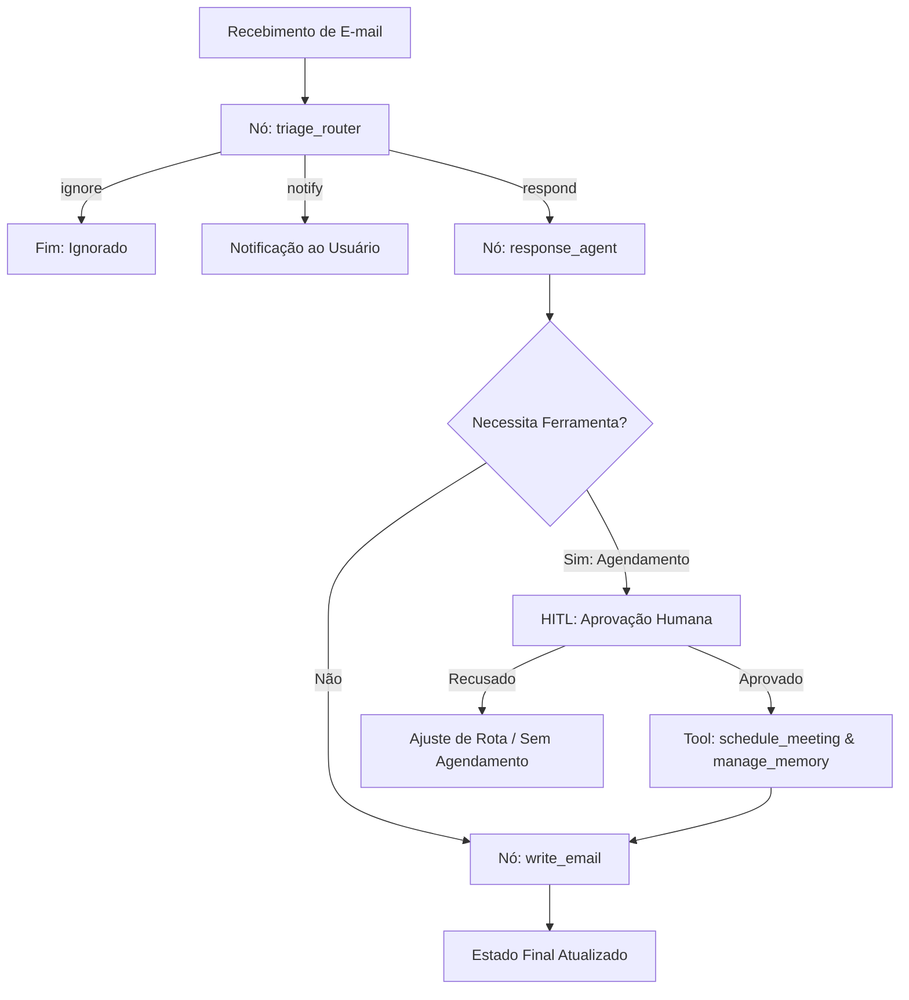

# 🤖 LangGraph Email Copilot: Semantic Router, HITL & Local Memory

Arquitetura corporativa de orquestração de agentes de IA para processamento autônomo e triagem de fluxos de comunicação, integrando **Human-in-the-Loop (HITL)** para ações críticas e **Memória Semântica de Longo Prazo**, operando 100% on-premises com **Ollama**.

---

## 🎯 Visão Executiva & Decisões de Engenharia

Recrutadores e times de engenharia enfrentam desafios ao levar LLMs para produção: alucinações, custos com APIs em nuvem e risco de ações autônomas não supervisionadas. Este projeto resolve isso através de três pilares:

1. **State Machine Confiável (LangGraph)**: Controle determinístico de transições de estado, garantindo que o agente só acesse ferramentas após a triagem.
2. **Supervisão Humana (Human-in-the-Loop - HITL)**: Operações sensíveis (como agendamentos em calendário) solicitam autorização antes do commit de estado.
3. **Privacidade e Custo Zero**: Pipeline alimentado via Ollama local (`llama3.2:1b`), garantindo conformidade com dados confidenciais corporativos.

---

## 🏗️ Arquitetura do Sistema



---

## 🛠️ Stack Tecnológica

| Componente | Tecnologia | Finalidade |
| :--- | :--- | :--- |
| **Orquestração** | LangGraph & LangChain | Máquina de estados orientada a grafos com persistência |
| **LLM Inference** | Ollama (`llama3.2:1b`) | Inferência local de alto desempenho e latência reduzida |
| **Interface** | Streamlit | Dashboard para demonstração e observabilidade de decisões |
| **Ambiente** | Python 3.11 / PowerShell | Execução padronizada e reprodutível |

---

## 🚀 Como Executar

### 1. Pré-requisitos
Certifique-se de que o **Ollama** está rodando localmente com o modelo:
```powershell
ollama run llama3.2:1b
```

### 2. Execução via Terminal (CLI)
```powershell
py -3.11 .\email_assistant_memory.py
```

### 3. Execução via Dashboard Interativo
```powershell
py -3.11 -m streamlit run .\app_dashboard.py
```

---

## 📊 Estrutura do Módulo

```text
langgraph-orchestration-agent/
├── .env                        # Configurações de ambiente locais
├── prompts.py                  # Engenharia de prompts e personas
├── email_assistant_memory.py   # Implementação do StateGraph + HITL + Memory
├── app_dashboard.py            # Interface gráfica Streamlit para apresentação
└── README.md                   # Documentação técnica e arquitetura
```